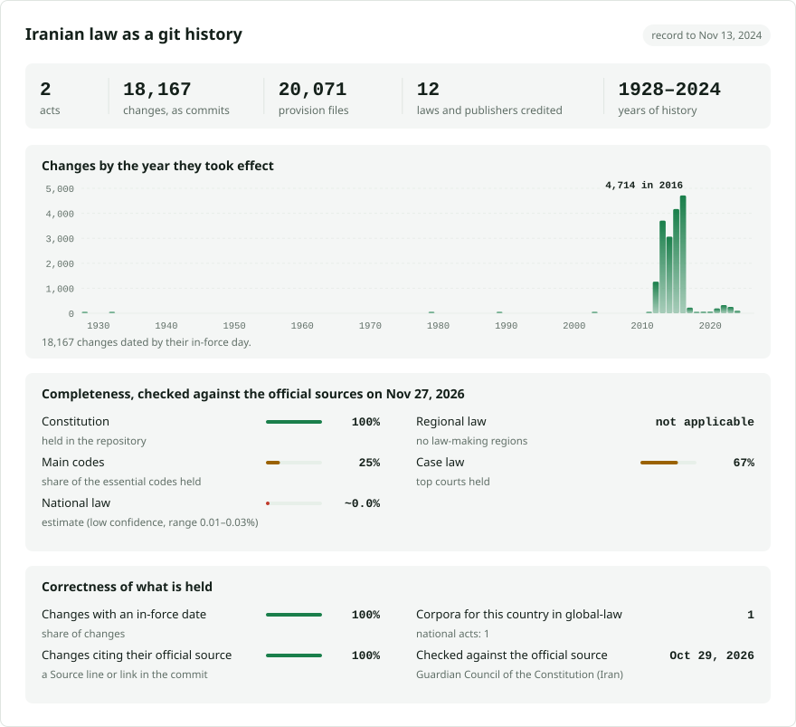

# Iran: law history in git

<picture>
<source media="(prefers-color-scheme: dark)" srcset="data/effort-dark.svg">

</picture>

The law of Iran as a git history: one file per provision, one commit per version on the day it took effect, and the act that made each change as the commit's author. `git blame` names the act behind every article; `git log` lists every change to an article; picking a date gives the text in force that day.

Part of [lexifina/global-law](https://github.com/lexifina/global-law), one git history for every country's law: this is Iran's national law, which global-law reads at `iran/national/acts/`.

**What is in it now:** the Constitution of the Islamic Republic of Iran (1979, as revised 1989), in one version: the English translation the Guardian Council of the Constitution publishes, with its preamble and 177 articles (178 files). No statute, decree or regulation is here yet. [`constitution/README.md`](constitution/README.md) lists every provision; [`REPRODUCE.md`](REPRODUCE.md) says how the files were made.

Each act is a folder with one file per provision: `constitution/art-001.md` is Article 1 and `constitution/preamble.md` the preamble.

The text is in English, as the Guardian Council publishes it. The Persian text, the authoritative one, is not part of this record.

## Questions as git commands

| Question | Command |
| --- | --- |
| Every change to Article 1 of the Constitution | `git log -p --word-diff -- constitution/art-001.md` |
| Which act wrote each line of Article 1? | `git blame constitution/art-001.md` |
| Every version of the Constitution, with the day each took effect | `git log --format="%h %(trailers:key=In-force,valueonly,separator=) %an" -- constitution ":^constitution/README.md"` |
| Article 1 as in force on 1 January 2026 | `python tools/on.py 2026-01-01 constitution art-001` |

**Outside git**, we also host this record publicly, for free:

- **[Ask Claude about Iranian law](https://global-law.lexifina.com/v1/try_claude?country=iran)**: opens Claude with a first question ready.
- **[Ask ChatGPT](https://global-law.lexifina.com/v1/try_chatgpt?country=iran)**: the same question in ChatGPT.
- **[Search Iranian law on our site](https://lexifina.com/law?country=iran&q=freedom+of+expression)**: a search for "freedom of expression", with each provision's text and its versions, no account needed.
- **[Developer REST API](https://global-law.lexifina.com/v1/search_law?query=freedom+of+expression&jurisdiction=iran)**: the same search as JSON, with no key. See the [documentation here](https://lexifina.com/api/global-law).

Both assistants read the record through the free Global law connector (MCP, `https://global-law.lexifina.com/mcp`); the first time, the chat gives you the link that adds it. Ask in English.

**Host it yourself easily.** All it takes is git and Python, and the tools run on your machine:

```sh
git clone --depth 1 https://github.com/lexifina/global-law && cd global-law
python3 tools/countries.py add iran/national/acts
python3 tools/law.py show 2026-01-01 iran/national/acts/constitution/art-001.md
```

Opened in Claude Code, Cursor, VS Code or Codex, the clone also starts a local MCP server with the same tools ([MCP.md](https://github.com/lexifina/global-law/blob/main/MCP.md)).

## Dates

Each commit is dated at noon, Asia/Tehran, on the day the version took effect, and carries it in its `In-force:` trailer:

- the Guardian Council's page gives no date for its text; with 177 articles it is the 1989 revision, so the one version is dated 28 July 1989, the day the referendum approved the revision (under Article 177 a revision takes effect once a referendum approves it);
- the original 1979 text, in force from 3 December 1979, is not recorded as a version of its own.

The version is credited to the publisher, the Guardian Council of the Constitution, as the "oldest version available" (`Kind: publisher`), not to a law; the committer is Lexifina.

## How it is checked

- `tools/check_repo.py` reads every version back from git on the day it took effect and on the day before and compares it with the corpus, whose hash is in `data/corpus.sha256`; it also checks that every commit's trailers parse, that `main` has no merge commits and that no commit is dated in the future.
- `tools/build.py` writes the history from that one corpus file, and the same corpus gives the same commit hashes. [`REPRODUCE.md`](REPRODUCE.md) records that the checks were not yet run for this build and that no second build has been compared.
- The sha256 of the source bytes the text was parsed from is in `data/versions.json`. Spacing, quotes and dashes are normalised; the wording is the translation's own.
- [vulnerabilities/](vulnerabilities/): possible drafting mistakes in this law, found by global-law's detectors and checked by hand. Not run yet.

## What it does not show

- **Amendments.** The Guardian Council publishes only the current text, so the 1979 text and the 1989 revision are not separate versions.
- **The Persian text**, which is authoritative.
- **Statutes, decrees and regulations.** None yet.
- **Apparatus.** Chapter and section headings, footnotes and the translator credits are left out, and the Guardian Council's interpretations of articles are not included.

## Sources

| Source | Kind | Past versions | Notes |
| --- | --- | --- | --- |
| [Guardian Council of the Constitution](https://www.shora-gc.ir/en/news/87/constitution-of-the-islamic-republic-of-iran-full-text) | Official English translation of the Constitution | no, the current text only | Read on 29 October 2026; the Persian text is authoritative |
| [Islamic Parliament Research Center](https://rc.majlis.ir/fa/law) | Persian Constitution and codes, as enacted | yes, from the Majlis volumes | Read on 2 November 2026 |
| [سامانه ملی آرای قضایی](https://ara.jri.ac.ir/), Judiciary Research Institute | Court judgments, parties as initials | one per case | Family, minors and sexual-offence cases are not published here |
| Hugging Face dataset [endomorphosis/ipfs_iran_laws](https://huggingface.co/datasets/endomorphosis/ipfs_iran_laws) | Third-party copy of [dotic.ir](https://dotic.ir), the official Iranian law portal: regulations and the general boards' rulings | one per record | **Not yet checked against the official source**; to be verified against the official text when capacity allows. Each commit says so (`Source-status:`, `Verification:`) |

## Licence

See [`LICENSE`](LICENSE). The Guardian Council's page states no licence; the text is reproduced with attribution to it, and it does not endorse this repository. Lexifina's arrangement, commit messages, tables and tools are dedicated to the public domain under CC0 1.0.

No AI model wrote, translated or corrected legal text; the scripts were written by an AI model (see [`REPRODUCE.md`](REPRODUCE.md)).

## Visualisations

- [visualisations/](visualisations/): charts drawn from this repository. Not drawn yet.

## More

From [lexifina/global-law](https://github.com/lexifina/global-law):

- [FEATURES.md](https://github.com/lexifina/global-law/blob/main/FEATURES.md): every feature, and what every corpus must support (`git blame`, `law.py`, the MCP tools)
- [FAQ.md](https://github.com/lexifina/global-law/blob/main/FAQ.md): questions and answers · [CONTRIBUTING.md](https://github.com/lexifina/global-law/blob/main/CONTRIBUTING.md): proposing changes · [MCP.md](https://github.com/lexifina/global-law/blob/main/MCP.md): the MCP server · [REPRODUCE.md](https://github.com/lexifina/global-law/blob/main/REPRODUCE.md): how it was built · [CHANGELOG.md](https://github.com/lexifina/global-law/blob/main/CHANGELOG.md)
- [FRESHNESS.md](https://github.com/lexifina/global-law/blob/main/FRESHNESS.md): how current each corpus is · [Monitoring](https://github.com/lexifina/global-law/tree/main/monitoring): whether updates are running · [WATCHING.md](https://github.com/lexifina/global-law/blob/main/WATCHING.md): how each official source is watched for changes
- [performance/](https://github.com/lexifina/global-law/tree/main/performance): how fast the tools are, measured
- [visualisations/](https://github.com/lexifina/global-law/tree/main/visualisations): charts and bridges across the world's law
- [Vulnerabilities](https://github.com/lexifina/global-law/tree/main/vulnerabilities): mistakes in legislation as published
